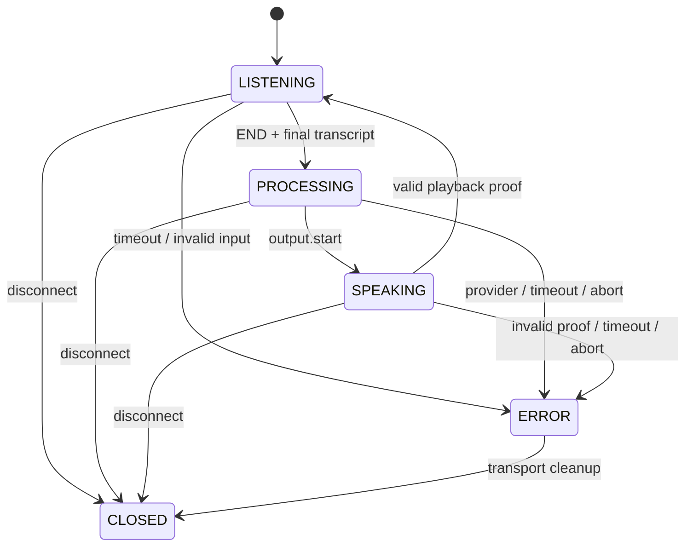

# D2-S2-05 — Local Xiaozhi gateway và dual-session foundation

> Báo cáo lịch sử Task 05. Cập nhật sau khôi phục dependency, source baseline và
> TX EOF experiment: [D2-S2-05-FIX](test-report-d2-s2-05-fix.md). Hardware vẫn BLOCKED.

Ngày kiểm tra: 03/11/2026, macOS / Python 3.14.3. **Chưa DONE cho hai robot thật.**
Phạm vi lượt này: `AI_SERVER/` và `xiaozhi-esp32/`. Không sửa/gọi Backend,
Frontend hoặc Database; không commit/push, erase hay flash.

## 1. Kết luận và hai board

Đã triển khai một endpoint development `/ws/dev-robot`, OFF mặc định, kết nối
pipeline có sẵn và native Opus. Hai client TCP thật chạy đồng thời với mock AI
và ACK mô phỏng. Không đồng nghĩa hai mạch thật hoặc Cloud đã chạy.

Đã rà 148 thư mục `config.json`, 179 variants, GPIO/audio/display từ source,
8 sdkconfig defaults, Kconfig, CMake và board factory. Inventory đầy đủ trong
`firmware-board-inventory.json`; tái tạo bằng `scripts/audit_firmware_boards.py`.
Script đọc source, không chọn board hay xác nhận phần cứng.

**Trong `xiaozhi-esp32/main/boards/custom/` chỉ có đúng một profile:**

- Path: `custom/xiaozhi-s3-tft`.
- Type/name: `xiaozhi-s3-tft`, manufacturer `custom`, target `esp32s3`.
- Kconfig: `CONFIG_BOARD_TYPE_XIAOZHI_S3_CUSTOM_TFT`.
- CMake chọn đúng directory; một `DECLARE_BOARD(XiaozhiS3TftBoard)`.
- `NoAudioCodecSimplex`: microphone 16 kHz, speaker 24 kHz; wire hello vẫn
  Opus 16 kHz mono/60 ms. Firmware có đường resampling ra sample rate codec.
- README vẫn ghi GPIO TFT tạm, chưa xác nhận với mạch thật. Không tự đổi pins.

| Dữ liệu đang có | D1 metadata | SD2 metadata / custom hiện có |
|---|---|---|
| AI catalog ID | `esp32-s3-wroom-1` | `esp32-s3-n16r8-tft-240x320` |
| Màn hình | ST7789 240×240 | ST7789 240×320 |
| SCK/MOSI/CS/DC/RST/BL | 42/41/NC/1/2/17 | 21/47/41/40/45/42 |
| Mic WS/BCLK/DIN | 4/5/6 | 4/5/6 |
| Speaker DOUT/BCLK/WS | 7/15/16 | 7/15/16 |
| Amplifier | NS4168 | MAX98357A |
| Bằng chứng | Diagram metadata, chưa gán firmware profile | Có custom source, README provisional |

Không coi hai catalog ID là hai board-directory ESP-IDF. Không tìm được profile
custom thứ hai tương ứng D1. Người dùng đang tìm lại profile/sơ đồ 1.54 inch.

### Kết quả tìm màn 1.54 inch

Có ảnh `xiaozhi-esp32/docs/v1/wmnologo_xingzhi_1.54.jpg`; đã xem, đây là ảnh sản
phẩm Nologo, không phải schematic/pinout. `docs/v1/wiring2.jpg` là ảnh breadboard
với màn OLED dài, không chứng minh mạch TFT 1.54 inch của dự án.

Có các source profile TFT/LCD 1.54 inch: `genjutech-s3-1.54tft`,
`nologo/xingzhi-cube-1.54tft-wifi`, `nologo/xingzhi-cube-1.54tft-ml307`,
`nologo/xingzhi-metal-1.54-wifi`, `spotpear/sp-esp32-s3-1.54-muma`,
`waveshare/esp32-s3-touch-lcd-1.54`, `waveshare/esp32-c6-touch-lcd-1.54`,
`zhengchen/1.54tft-wifi`, `zhengchen/1.54tft-ml307`. Ngoài ra có e-paper 1.54.

Ví dụ Nologo Cube Wi-Fi có mic/speaker pins 4/5/6 và 7/15/16 giống D1,
nhưng màn SCK/MOSI/CS/DC/RST/BL là **9/10/14/8/18/13**, khác D1.
Zhengchen 1.54 Wi-Fi/ML307 trùng SCK42/MOSI41 và các pins audio, nhưng
RST45/DC40/CS21/BL20 vẫn khác D1 (RST2/DC1/không CS/BL17).
GenjuTech và Spotpear dùng ES8311/pins khác. Chỉ trùng kích thước 240×240 không
đủ để tự chọn một trong các profile này. Chưa thấy schematic xác nhận D1 là
board 1.54 inch cụ thể. **Mapping hai board thực tế vẫn BLOCKED.**

## 2. Đã làm / chưa làm

Đã làm:

- WebSocket development riêng, bearer token local, IP allowlist private/loopback,
  hai slot mặc định; token và energy threshold bắt buộc khi bật. Không dùng
  Backend authorization, MAC hay wire session ID làm identity đã xác thực.
- Hello/version/profile validation; framing v1 raw, v2 16-byte, v3 4-byte;
  native libopus encode/decode thực tế, PCM16 mono conversion/rebuffer có giới hạn.
- Tái sử dụng AudioInput, TurnDetector, STT streaming interface, LLMRunner,
  TTS/PlaybackScheduler và AIOrchestrator; không viết lại pipeline.
- Session/turn/generation server cấp riêng; cùng Device-Id/Client-Id tự khai vẫn
  không chia sẻ context. Busy mic bị drop trước parsing/decoder/VAD/STT.
- `listen.stop` dừng ingress, ghi nhận silence, tiếp tục chờ điều kiện detector;
  không biến STT final hoặc manual stop thành END ngay lập tức.
- Ngưỡng thử nghiệm được duyệt 700/300/15000 ms có env cấu hình; turn timeout
  hủy, không tự END lúc speech. Energy activity là heuristic thử nghiệm trên PCM,
  **không phải VAD production hoặc đánh giá speech quality**.
- TTS mock tone → native Opus → bounded scheduler → socket; ordered chunks,
  scoped ready/complete, cancel/timeout/disconnect/late audio rejection.
- Firmware extension thương lượng `aiva_half_duplex_v1`, dùng chung core, không
  thay board, display, camera, nút hoặc GPIO riêng. Legacy/MQTT không bật extension.
- Firmware local build flag `CONFIG_AIVA_DEV_VOICE` mặc định n: khi bật bỏ qua
  activation/OTA bootstrap, dùng NVS websocket đã provision, không fallback MQTT.
- Guard đếm received/checked-write, chống stale callbacks, chỉ ready sau reset/
  software drain, chỉ complete khi còn có **driver output-drained evidence**.

Chưa làm / bị chặn:

- Chưa xác định hai board thực tế; không tạo một board thứ hai bằng suy đoán.
- Chưa có ESP-IDF hoặc vendor managed components để build firmware.
- **`AudioCodec::IsOutputDrained()` hiện mặc định false, chưa có driver override.**
  Software queue drain và `OutputDataChecked()` chỉ chứng minh đã ghi đủ mẫu,
  không chứng minh DMA/loa hết dữ liệu. Firmware hiện **không gửi complete** chỉ
  từ queue drain; giữ SPEAKING, server timeout/cancel/đóng kết nối. Muốn nghiệm
  thu hardware cần driver-specific TX completion, build và kiểm tra thực tế.
- Cloud STT/TTS Provider/model/voice/profile/credential chưa chốt; OpenAI LLM
  live chưa có secret delivery/credential. Không gọi Cloud. TTS ở đây là tone,
  STT trả cố định, LLM scripted; không phải robot đã nói chuyện.
- Provision NVS từng robot, Wi-Fi/serial và physical audio/capture chưa kiểm tra.
- MQTT/UDP representative firmware build, hardware stop/drain và Cloud latency
  chưa chạy. Không tuyên bố legacy firmware toàn bộ đã PASS chỉ bằng host tests.

ESP-IDF phân biệt ghi DMA và callback `on_sent`; xem header chính thức
[v6.0.2 i2s_common.h](https://github.com/espressif/esp-idf/blob/v6.0.2/components/esp_driver_i2s/include/driver/i2s_common.h).
Không thay TX evidence bằng số ms ước lượng hoặc tts.stop.

## 3. Files của lượt này

| File | Trách nhiệm |
|---|---|
| `app/core/robot_config.py` | Explicit development gate, token/private networks/limits/thresholds |
| `app/api/robot_websocket.py` | Auth local, hello/control/frame validation, một orchestrator/session |
| `app/services/opus_codec.py` | Native Opus, PCM16 conversion/rebuffer, cleanup |
| `app/services/robot_transport.py` | Mock PCM → Opus, scoped WebSocket AudioOutput và proof validation |
| `app/protocol/audio_framing.py` | Thêm encoder envelope, tái sử dụng validator |
| `app/services/orchestrator.py` | Bổ sung accepting_input và manual stop, giữ pipeline có sẵn |
| `app/models/tts.py` | Thêm evidence source cho extension development |
| `app/main.py` | Đăng ký route, shared LLM concurrency limiter và slot budget |
| `requirements.txt` | Khai báo anyio trực tiếp cho cancellation shield |
| `tests/test_robot_gateway.py` | Native codec, ASGI và TCP integration, mock AI |
| `tests/test_orchestrator.py` | Regression manual stop, đủ silence, không replay mic |
| `scripts/robot_mock_client.py` | Hai client TCP đồng thời, Opus thật, ACK giả có nhãn |
| `scripts/audit_firmware_boards.py`, `docs/firmware-board-inventory.json` | Inventory source board |
| `README.md`, `AGENTS.md`, `docs/protocol.md`, báo cáo này | Cách chạy và trạng thái thực tế |
| Firmware `main/Kconfig.projbuild` | Local voice build flag OFF |
| Firmware `main/protocols/{protocol.*,websocket_protocol.*}` | Feature negotiation, validation, scoped playback messages |
| Firmware `main/protocols/voice_playback_guard.h` | Count/generation/drain guard host-testable |
| Firmware `main/application.{cc,h}` | TTS extension lifecycle, no barge-in khi speaking, disconnect cleanup |
| Firmware `main/audio/{audio_codec.*,audio_service.*}` | Checked write callback, fail-closed driver drain seam |
| Firmware `scripts/tests/test_voice_playback_guard.py` | Compile/run C++ guard trên host |
| Firmware `AGENTS.md`, `docs/aiva-dev-voice.md` | Hiện trạng và contract development |

Các file Backend client/test/report từ lượt trước được giữ, không gọi từ endpoint
này. Không tính chúng là thay đổi Backend hoặc live Backend integration lượt này.

## 4. Luồng và state machine

```text
Firmware hello(version/profile + feature) + local bearer token
  → private development gateway → server-generated session scope
  → listen.start → Opus frame validator → native decoder → PCM AudioInput
  → experimental energy activity + mock STT partial → TurnDetector END
  → finish turn input → mock STT final → LLMRunner/mock streaming once
  → safe complete sentences → MockTTS PCM tone → native Opus
  → PlaybackScheduler bounded queue → tts.start → wait scoped ready
  → ordered binary chunks → tts.stop(audio_chunks)
  → wait scoped complete(count + turn + generation) → next turn
```



Framing không thêm field turn vào binary format. Ready handshake bảo đảm decoder
đã reset trước khi server gửi audio. ID nội bộ/generation được map vào extension
control JSON đã triển khai hai phía; không tuyên bố đây là Xiaozhi upstream chuẩn.
Không ACK thì không mở nghe tiếp. Endpoint timeout sẽ dọn pipeline và đóng phiên;
không reset blocked scheduler để giả tạo bằng chứng loa đã dừng.

## 5. Chạy trên macOS

Từ root repo:

```bash
cd AI_SERVER
python3 -m venv .venv
.venv/bin/python -m pip install -r requirements-dev.txt
brew install opus  # nếu máy chưa có libopus
.venv/bin/python -m pip check
```

libopus của máy kiểm tra: `/opt/homebrew/lib/libopus.dylib`. Không thêm Cloud SDK/
model/voice mới. Secret local chỉ để giới hạn môi trường development, không phải
Backend token hoặc API key Cloud. Tạo token ngẫu nhiên không in ra log:

```bash
export AI_SERVER_ROBOT_TOKEN="$(.venv/bin/python -c 'import secrets; print(secrets.token_urlsafe(32))')"
export AI_SERVER_ROBOT_ENABLED=true
export AI_SERVER_ROBOT_ENERGY_THRESHOLD=100
export AI_SERVER_ROBOT_MIN_SILENCE_MS=700
export AI_SERVER_ROBOT_TRANSCRIPT_STABILITY_MS=300
export AI_SERVER_ROBOT_MAX_TURN_DURATION_MS=15000
export AI_SERVER_RELOAD=false
export AI_SERVER_HOST=127.0.0.1
.venv/bin/python scripts/run_dev.py
```

`100` là fixture energy threshold để thử tone, không phải thông số VAD đã duyệt
production. RobotSettings đọc process environment; không tự đọc `.env` Cloud.
Chạy demo trong terminal cùng environment/token (không copy token vào chat/Git):

```bash
.venv/bin/python scripts/robot_mock_client.py
```

Nếu dùng LAN riêng: bind **địa chỉ LAN cụ thể** của Mac và thêm đúng subnet vào
`AI_SERVER_ROBOT_ALLOWED_NETWORKS`, ví dụ JSON `["127.0.0.0/8","192.168.1.0/24"]`
chỉ khi đây là LAN thực tế của bạn. Dùng cùng địa chỉ trong `--url` và NVS robot.
Không port-forward, public proxy hoặc expose dev endpoint. Mặc định allowlist chỉ
loopback; ASGI proxy headers bị tắt trong `run_dev.py`. Quản trị firewall/LAN là
điều kiện vận hành, IP allowlist không thay thế identity production.

Không khởi động Backend. Echo vẫn ở `/ws/dev-echo` và chỉ local:

```bash
.venv/bin/python scripts/ws_client.py --message 'Xin chào AIVA'
.venv/bin/python -m pytest tests/test_robot_gateway.py -q --tb=short
.venv/bin/python -m pytest tests -q --tb=short
.venv/bin/python scripts/orchestrator_mock_demo.py
.venv/bin/python scripts/audit_firmware_boards.py
```

### Build / flash / monitor

Chưa có hai board đã xác nhận nên **không có cặp lệnh flash an toàn để thực thi**.
Không đoán `/dev/cu.*`. Máy hiện chỉ thấy AuraBulb/Bluetooth/debug-console/
wlan-debug; chưa có mapping serial → hai robot.

Sau khi có ESP-IDF 6.0.2 và xác nhận mapping:

```bash
source /duong/dan/esp-idf/export.sh
cd xiaozhi-esp32
idf.py --version
python3 scripts/build.py --list-boards
python3 scripts/build.py custom/xiaozhi-s3-tft --name xiaozhi-s3-tft
python3 -m unittest discover -s scripts/tests -v
```

Lệnh custom ở trên là build profile **đang tồn tại**, không xác nhận đúng mạch
thật, không bật dev flag, và chưa chạy ở môi trường này. Mỗi variant canonical
có config riêng; build script đổi sdkconfig/build state, không build song song
hai variant trong cùng checkout. Muốn local voice, tạo config development riêng
cho board đã xác nhận, thêm `CONFIG_AIVA_DEV_VOICE=y` vào `sdkconfig_append`, dùng
`--config <filename>` của build script; không hardcode GPIO hoặc key trong source.
Giữ production config gốc. Chưa tạo dev variants cho hai board chưa xác định.

Chỉ sau khi đối chiếu board, chip, flash size, partition table và port tương ứng:

```bash
# TEMPLATE, chưa được phép áp vào cổng suy đoán:
idf.py -p "$CONFIRMED_PORT_FOR_CURRENT_BUILD" flash monitor
```

Chạy đúng build hiện hành của từng board trước flash, hoặc dùng hai checkout
build độc lập. Không dùng offset NVS/flash của board khác. NVS namespace
`websocket` phải được provision riêng `url`, `token`, `version` (1/2/3) bằng quy
trình thiết bị đã xác nhận; task này không ghi NVS, không erase, không đoán layout.
Chưa đủ contract/mapping để đưa lệnh provision/flash cụ thể cho từng mạch.

## 6. Test và số đo thực tế

Venv thực thi `/private/tmp/aiva-stt-task02-venv`. Test TCP chạy ngoài socket
sandbox bằng quyền chạy local; không gọi Internet/Backend/Cloud.

| Kiểm tra | Kết quả thực tế |
|---|---|
| Full `python -m pytest tests -q --tb=short` | **FAIL: 375 passed, 1 failed**, 23.92 s |
| Targeted gateway/orchestrator/TTS trước 6 case cuối | PASS: 89 passed, 11.31 s |
| Gateway cuối `python -m pytest tests/test_robot_gateway.py -q --tb=short` | PASS: 30 passed, 12.05 s |
| Bốn case bổ sung malformed hello/PCM profile & padding | PASS: 4 passed |
| Hai regression bổ sung late output/manual stop | PASS trong full suite |
| TCP loopback hai client đồng thời v1/v3 | PASS, 2 audio packets/session, 1920 decoded samples/session |
| ASGI v1/v2/v3, turn tiếp theo sau proof | PASS trong full suite |
| `python3 -m unittest discover -s scripts/tests -v` | PASS: 69 tests, gồm C++ guard compiled bằng clang++ |
| `python -m pip check` | PASS: no broken requirements |
| `git diff --check` | PASS tại thời điểm kiểm tra code |
| ESP-IDF build hai mạch, MQTT representative build | BLOCKED: thiếu SDK/deps và mapping board |
| clang-format | NOT RUN: chưa có executable |
| Flash / monitor / hai robot thật / acoustic playback | NOT RUN: board và ports chưa xác nhận |
| Driver DMA/output completion | BLOCKED: chưa có concrete driver override/proof |
| Cloud STT/LLM/TTS E2E | BLOCKED: config/credential chưa đủ |
| Backend integration | DEFERRED theo scope mới; không dùng Backend |

Full suite FAIL ở `test_firmware_snapshot_hashes_match_workspace_sources`:
snapshot cũ ghi hash của source trước extension, nên hiện fail ngay
`main/protocols/protocol.h`. Đối chiếu riêng thấy 8 source snapshot đã thay đổi,
và 3 file managed dependency ML307 vẫn thiếu. **Không sửa/skip snapshot test hoặc
fixture để che FAIL**; cũng không tạo vendor files giả ngoài toolchain.

Đã có lần thử TCP trong sandbox bị `PermissionError` khi bind; lần chạy được cấp
quyền loopback đã PASS. Một test timeout ban đầu chỉ chờ close nhưng thực tế nhận
`tts.abort` trước close; đã sửa assertion kiểm tra đúng cleanup rồi chạy lại.
Các lần gọi sai đường dẫn/cwd không được tính PASS.

Các ca chính: disabled/token/private gate, overload, wrong session/proof, hello
sai/binary/duplicate JSON keys/oversized, invalid frame/Opus, native PCM resampling
8/12/16/24/48 kHz, bounded PCM chunks/padding/cleanup, no ACK timeout, cancel,
disconnect/reconnect, hai session cùng MAC tự khai vẫn độc lập, busy mic drop,
late output/ACK reject, manual stop chưa đủ silence không gọi LLM.

Guard C++ kiểm tra ready trước audio, expected/received/played counts, duplicate
END, failed write, late generation callbacks, cancel, independent guard, và
**không complete khi chỉ software queue drained, chưa có output proof**.

Demo mock orchestrator đã chạy, một LLM request/turn, audio order
`[(0,0),(0,1),(1,0)]`, SPEAKING drop mic, mock proof mới LISTENING:

| Session | STT ms | LLM first token ms | TTS first audio ms | Total ms |
|---|---:|---:|---:|---:|
| Mock A | 1.34 | 21.00 | 10.71 | 96.56 |
| Mock B | 1.05 | 20.91 | 10.40 | 96.34 |

Đây là fixture/scripted delays và clock điều khiển; không gồm chất lượng nhận
giọng, độ trễ mạng Cloud hay phần cứng, không phải latency mục tiêu nghiệm thu.
Chưa đo được tỷ lệ cắt câu quá sớm hoặc khoảng chờ sau câu trên người nói thật.

## 7. Bước tiếp theo

1. Xác nhận profile thứ hai và mạch 1.54 inch từ sơ đồ/build log/board revision;
   xác nhận sáu GPIO TFT và thiết bị serial của custom hiện có.
2. Cài/kích hoạt ESP-IDF 6.0.2, resolve managed dependencies theo toolchain;
   build từng variant độc lập, kiểm tra flash/partition và regression MQTT/WS.
3. Triển khai driver-specific TX/DMA completion cho codec thực tế, test ISR,
   reset/abort/error/drain trên hai board. Không override IsOutputDrained bằng
   `true` hoặc thời lượng ước tính để mở khóa.
4. Provision NVS theo từng robot rồi nghiệm thu mic/Opus/loa/half-duplex/two-session
   bằng phần cứng. Mock ACK không thay thế bằng chứng phát thật.
5. Chốt STT/TTS/Cloud secrets và audio conversion quality, tích hợp adapters thật;
   Backend authorization/quota/usage sẽ là task riêng khi scope cho phép.
